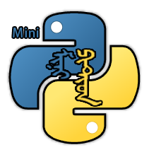

<div align="center">



<p>
  <a href="https://www.minipy.site"></a>
  &nbsp;
  <a href="https://www.minipy.site/docs.html#api"></a>
</p>

# MiniPython

**可以嵌入其他程序，也可以独立运行、不依赖外部 Python 环境的轻量解释器**

[](LICENSE)
[](https://en.wikipedia.org/wiki/C%2B%2B20)
[](https://github.com/RySoftware/MiniPython)

[English](#english) | [中文](#中文)

</div>

---

## 中文

### 项目简介

MiniPython 是一款用 C++20 编写的开源、跨平台 Python 解释器库。它既可以作为轻量独立解释器运行 `.py` 脚本，也可以通过 C-API 嵌入到任何 C/C++ 宿主程序中，为软件产品注入脚本扩展能力。

**核心优势：**

- **体积小巧** — 整个核心仅由几十个头源文件组成，编译产物紧凑，适合对二进制体积敏感的场景
- **零外部依赖** — 核心解释器不依赖任何第三方库，链接即可使用
- **架构开放** — 内置 FFI 机制，可自由注册原生函数、类和数据，也能装载 `.pyd` / `.dll` / `.so` / `.dylib` 扩展模块
- **开发集成便捷高效** — 统一的 C-API 句柄模型、完整的错误处理、自动引用计数，一行 `#include <MiniPython/minipy.h>` 即可集成
- **兼容 Python 二进制扩展生态** — 支持加载 `.pyd` 扩展库，能够复用现有的 Python 二进制扩展模块
- **跨平台** — 统一平台层封装动态库加载、可执行内存、系统错误码、字符编码与路径处理，已覆盖 Windows / Linux / macOS / iOS / Android / HarmonyOS，并可编译到 Emscripten / WASI (WebAssembly)

### 最新更新

- **跨平台支持** — 新增 `platform.hpp` / `platform.cpp`，把 `LoadLibrary`/`dlopen`、`VirtualAlloc`/`mmap`、系统错误码与 UTF-8 转换等平台差异集中到一层
- **C-API 补全** — 新增反射（`mp_vm_find_class` / `mp_vm_find_function`）、类与动态建类、复数、`bytes`、异常对象、dict 视图、格式化、模式匹配、堆快照等接口
- **标准库扩充** — 已实现模块从最初 18 个扩展到 70+，新增 `cmath`、`fractions`、`collections`、`enum`、`pickle`、`pathlib`、`unittest` 等
- **数据类型** — 新增复数 `complex` 与 `bytearray` 支持，`mp_value_kind` 同步新增 `MP_KIND_COMPLEX` / `MP_KIND_BYTES` / `MP_KIND_EXCEPTION`

### 技术架构

MiniPython 采用经典的三段式编译管线：

```
源码 → 词法分析器 (lexer) → 语法分析器 (parser) → 字节码虚拟机 (vmware)
```

- **lexer** — 将 Python 源码切分为 token 序列，支持字符串、数字、标识符、缩进/f-string 等完整 token 类型
- **parser** — 递归下降语法分析器，将 token 流编译为内部 IR（`execute_t` 指令序列）
- **vmware** — 基于寄存器栈混合模型的字节码虚拟机，内置引用计数堆管理器
- **platform** — 跨平台抽象层，屏蔽动态库加载、可执行内存、错误码与字符编码的平台差异

### 功能特性

#### 语言特性

| 特性 | 说明 |
|------|------|
| 完整 Python 3 语法 | 函数、类、装饰器、闭包、生成器、协程、`async/await` |
| 类与继承 | 单继承 / 多继承 / 继承内置类型 / `super()` / `isinstance` / `issubclass` |
| 描述器协议 | `__get__` / `__set__` / `__delete__` |
| 模式匹配 | `match-case` 完整支持 |
| 异常处理 | `try/except/else/finally` / `raise` / 异常链 |
| 迭代协议 | `__iter__` / `__next__` / 可迭代对象统一迭代 |
| 推导式 | 列表、字典、集合推导式 |
| 解包赋值 | `a, *b, c = iterable` |
| f-string | 表达式插值与格式说明 |

#### 数据类型

`None` · `int` · `float` · `bool` · `complex` · `str` · `bytes` · `bytearray` · `list` · `tuple` · `dict` · `dict_keys/values/items` 视图 · `range` · `set` · `frozenset` · 切片 · 生成器 · 异常对象 · 原生 FFI 对象 · 脚本类实例

#### 已实现标准库

```
argparse   array      atexit     base64     binascii   bisect     builtins
calendar   cmath      codecs     collections colorsys  configparser contextvars
copy       csv        ctypes     difflib    doctest    enum       filecmp
fnmatch    fractions  gc         getopt     glob       graphlib   heapq
html       http.cookies imghdr   io         itertools  json      logging
marshal    math       numbers    operator   optparse   os        os.path
pathlib    pickle     pprint     profile    queue      random    re
reprlib    sched      secrets    shutil     sndhdr     statistics string
struct     sys        tempfile   textwrap   time       timeit    tomllib
traceback  types      unittest   urllib.parse uuid      warnings  wave
```

内置函数覆盖 `abs`、`all`、`any`、`bin`、`bool`、`chr`、`compile`、`dict`、`dir`、`enumerate`、`eval`、`exec`、`filter`、`float`、`format`、`getattr`、`hash`、`int`、`isinstance`、`len`、`list`、`map`、`max`、`min`、`next`、`print`、`range`、`repr`、`sorted`、`str`、`sum`、`tuple`、`type`、`zip`、`__import__` 等八十余个。

### C-API 概览

MiniPython 对外暴露一组纯 C 接口（`minipy.h`），所有内部实现细节完全隐藏。以下示例是可独立编译运行的完整 C 程序：

```c
#include <stdio.h>
#include <MiniPython/minipy.h>

// 被嵌入的原生函数 —— 必须在文件作用域定义, 签名固定
// 返回 MP_OK 表示成功, 非零值表示异常
static int my_add(void* userdata, void* ctx, void** out) {
    void* vm = mp_ctx_vm(ctx);
    long long a = mp_value_as_int(mp_ctx_arg(ctx, 0));
    long long b = mp_value_as_int(mp_ctx_arg(ctx, 1));
    *out = mp_int(vm, a + b);     // 从 vm 构造返回值句柄
    return MP_OK;
}

int main(void) {
    // 1. 创建解释器 + 加载标准库
    void* vm = mp_vm_new();
    mp_vm_use_stdlib(vm);

    // 2. 执行一段脚本
    mp_vm_exec_main(vm, "print('Hello, MiniPython!')");

    // 3. 注册原生函数到 FFI 库
    //    注意: mp_vm_load_lib 只把库注册到解释器内部的 cffiLibraries,
    //    不会自动往全局作用域 setVariable 模块名。
    //    所以 import mylib 和 mp_call_name("mylib.add") 都不工作。
    //    正确的做法是: 用 from mylib import add 让 importlib 把成员注入全局作用域。
    void* lib = mp_lib_new("mylib");
    mp_lib_add_function(lib, "add", (void*)my_add, NULL);
    mp_vm_load_lib(vm, lib);

    // 4. 触发 from-import, 把 mylib.add 注入全局作用域
    mp_vm_exec_main(vm, "from mylib import add");

    // 5. C 侧直接调: get_global("add") → call
    void* args[] = { mp_int(vm, 3), mp_int(vm, 4) };
    void* fn    = mp_vm_get_global(vm, "add");
    void* result = mp_call(vm, fn, args, 2);

    // 6. 读回结果
    long long sum = mp_value_as_int(result);
    printf("mylib.add(3, 4) = %lld\n", sum);

    // 7. 更简洁的方式: 直接让 Python 脚本调 —— 一行解决
    mp_vm_exec_main(vm, "from mylib import add; print(add(100, 200))");

    // 8. 也可以用 from mylib import * 批量注入
    mp_vm_exec_main(vm, "from mylib import *");

    // 9. 显式注入全局变量, 让脚本里能用到
    mp_vm_set_global(vm, "tag", mp_str(vm, "from C"));
    mp_vm_exec_main(vm, "print('tag =', tag)");

    // 10. 清理: 先释放值, 再销毁解释器
    mp_value_release(fn);
    mp_value_release(result);
    mp_vm_free(vm);
    return 0;
}
```

#### API 模块一览

| 模块 | 说明 |
|------|------|
| 解释器生命周期 | `mp_vm_new` / `mp_vm_free` / `mp_vm_use_stdlib` |
| 脚本执行 | `mp_vm_exec_source` / `mp_vm_exec_main` / `mp_vm_load_source` / `mp_vm_run` |
| 字节码 | `mp_vm_compile_bytecode` / `mp_vm_load_bytecode` |
| 模块加载 | `mp_vm_add_module` / `mp_vm_load_pyd` |
| 全局变量 | `mp_vm_get_global` / `mp_vm_set_global` / `mp_vm_del_global` |
| 值构造 | `mp_none` / `mp_int` / `mp_float` / `mp_bool` / `mp_str` / `mp_list` / `mp_tuple` / `mp_dict` / `mp_range` / `mp_complex` / `mp_exception` |
| 值读取 | `mp_value_as_int` / `mp_value_as_float` / `mp_value_as_bool` / `mp_value_as_str` / `mp_value_as_bytes` / `mp_value_as_complex` |
| 容器操作 | `mp_seq_append` / `mp_dict_set` / `mp_dict_get` / `mp_dict_items` / `mp_dict_view` / `mp_dict_get_index` |
| 调用与运算 | `mp_call` / `mp_call_kw` / `mp_call_method` / `mp_binary` / `mp_unary` |
| 属性与下标 | `mp_getattr` / `mp_setattr` / `mp_getitem` / `mp_setitem` |
| 反射与类型 | `mp_vm_find_class` / `mp_vm_find_function` / `mp_value_class` / `mp_value_dir_names` / `mp_value_container` |
| 类与对象 | `mp_make_object` / `mp_create_class` / `mp_bind_method` / `mp_super` |
| 格式化与匹配 | `mp_apply_format` / `mp_percent_format` / `mp_match_pattern` |
| 模块与堆 | `mp_vm_has_lib` / `mp_vm_heap_count` / `mp_vm_heap_snapshot` |
| 迭代 | `mp_iterate` |
| FFI 扩展 | `mp_lib_new` / `mp_class_new` / `mp_vm_load_lib` |
| 原生回调 | `mp_ctx_arg` / `mp_ctx_kwarg` / `mp_ctx_vm` / `mp_ctx_self` |
| 错误处理 | `mp_vm_last_error` / `mp_vm_exception_type` / `mp_vm_save_error` |
| 引用计数 | `mp_value_retain` / `mp_value_release` |

> `mp_value_kind` 在原有类型之外新增 `MP_KIND_COMPLEX`、`MP_KIND_BYTES`、`MP_KIND_EXCEPTION`。

### C++ 直接调用（vm 类接口）

MiniPython 的核心引擎是 `minipy::vm` 类，包含词法分析器、语法分析器、字节码虚拟机全部能力。C++ 项目可以直接 `#include <MiniPython/minipy.h>`，通过 `vm` 类以面向对象方式使用全部功能，无需经由 C-API 句柄层。

以下示例全部可独立编译运行。

#### 最简：启动 + 执行脚本

```cpp
#include <MiniPython/minipy.h>
#include <iostream>

int main() {
    minipy::vm engine;
    engine.usestdlib();          // 加载全部内置标准库
    engine.execSource(R"(
import math
print('Hello, MiniPython!')
print(math.sqrt(2))
)");
    return 0;
}
```

#### 调用脚本中定义的函数

先用 `compile → setBytecode → run` 让编译结果落进 engine 的持久状态（`engine.script.functions` 是真正的 `function_t` 数组），然后直接按名遍历取出调用。

```cpp
#include <MiniPython/minipy.h>
#include <iostream>
#include <vector>

int main() {
    minipy::vm engine;
    engine.usestdlib();

    // compile → setBytecode 把函数表 move 进 engine.script.functions
    // run() 清空 scopes、push 全局 scope、执行顶层代码
    minipy::script_t compiled = engine.compile(R"(
def greet(name):
    return f'Hello, {name}!'

def add(a, b):
    return a + b
)");
    engine.setBytecode(compiled);

    // 现在 engine.script.functions 里真的有 greet 和 add 的 function_t
    for (auto& f : engine.script.functions) {
        if (f.name == "greet") {
            std::vector<minipy::value> args = { engine.makeString("World") };
            // invoke 的参数必须是 function_t*
            minipy::value result = engine.invoke(&f, args);
            std::cout << engine.toString(result) << std::endl;   // Hello, World!
        }
        if (f.name == "add") {
            std::vector<minipy::value> args = { engine.makeInt(3), engine.makeInt(4) };
            minipy::value sum = engine.invoke(&f, args);
            std::cout << engine.toInt(sum) << std::endl;   // 7
        }
    }
    return 0;
}
```

> **为什么不能只用 `execSource`？** `execSource` 把源码编译到**栈上局部** `script_t nested`，不写 `this->script`，也不管理 scopes 的 push/pop。所以之后 `engine.script.functions` 为空，也拿不到任何 `function_t*`。必须走 `compile → setBytecode` 这条管线。

#### 在 C++ 侧注册原生函数（FFI）

原生回调签名为 `minipy::value (*)(minipy::cffi&)`，`cffi` 上下文提供 `arg_int()`、`arg_float()`、`arg_str()`、`kwarg_bool()`、`mkstr()`、`mkint()`、`mkfloat()` 等便捷接口。

```cpp
#include <MiniPython/minipy.h>
#include <cmath>
#include <iostream>

// 被注册到 ffilib 的全局函数（不能是捕获型 lambda, 必须是纯函数指针）
static minipy::value cffiMySin(minipy::cffi& ctx) {
    double x = ctx.arg_float(0);          // 第 0 个位置参数转浮点
    return ctx.mkfloat(std::sin(x));      // 直接从 cffi 构造返回 value
}

static minipy::value cffiGreet(minipy::cffi& ctx) {
    std::string name = ctx.arg_str(0);                     // 位置参数
    bool excited = ctx.kwarg_bool("excited", false);       // 关键字参数, 带默认值
    std::string msg = "Hello, " + name + (excited ? "!" : ".");
    return ctx.mkstr(msg);
}

int main() {
    minipy::vm engine;
    engine.usestdlib();

    minipy::ffilib lib;
    lib.name = "mylib";

    // ffilib.functions 类型为 std::map<std::string, void*>
    // 回调签名是 minipy::cffi_native_function, 注册时强转为 void*
    lib.functions["my_sin"] = reinterpret_cast<void*>(cffiMySin);
    lib.functions["greet"]  = reinterpret_cast<void*>(cffiGreet);

    engine.loadlib(lib);

    // Python 侧直接 import 调用
    engine.execSource(R"(
import mylib
print(mylib.my_sin(0.0))                   # 0.0
print(mylib.greet('MiniPython'))           # Hello, MiniPython.
print(mylib.greet('World', excited=True))  # Hello, World!
)");
    return 0;
}
```

#### 操作 Python 容器（list / dict）

```cpp
#include <MiniPython/minipy.h>
#include <iostream>

int main() {
    minipy::vm engine;
    engine.usestdlib();

    // 构造 list
    minipy::value myList = engine.makeList({
        engine.makeInt(10),
        engine.makeFloat(2.5),
        engine.makeString("hi")
    });

    // 构造 dict 并逐项写入
    minipy::value myDict = engine.makeDict();
    engine.dictSet(myDict, engine.makeString("name"), engine.makeString("Alice"));
    engine.dictSet(myDict, engine.makeString("age"),  engine.makeInt(30));

    // 注入全局变量, Python 脚本中可直接使用
    engine.setVariable("data", myList);
    engine.setVariable("info", myDict);
    engine.execSource(R"(
print(data)               # [10, 2.5, 'hi']
print(info)               # {'name': 'Alice', 'age': 30}
print(info['name'])
)");

    // 从 Python 取回全局变量
    auto* back = engine.findVariablePtr("info");
    std::cout << engine.toString(*back) << std::endl;
    return 0;
}
```

#### 调用运算符 / 方法 / 下标

```cpp
#include <MiniPython/minipy.h>
#include <iostream>

int main() {
    minipy::vm engine;
    engine.usestdlib();

    minipy::value a = engine.makeInt(10);
    minipy::value b = engine.makeInt(3);

    // 二元运算
    minipy::value r1 = engine.applyBinary("+", a, b);    // 13
    minipy::value r2 = engine.applyBinary("/", a, b);    // 3.333...
    minipy::value r3 = engine.applyBinary("==", a, b);   // False

    // 一元运算
    minipy::value r4 = engine.applyUnary("-", a);        // -10

    // 属性访问: 先从全局表拿到 math 模块, 再读 pi
    minipy::value module = engine.findVariable("math");
    minipy::value pi = engine.getAttribute(module, "pi");
    std::cout << "pi = " << engine.toString(pi) << std::endl;

    // 下标
    minipy::value lst = engine.makeList({
        engine.makeInt(1), engine.makeInt(2), engine.makeInt(3)
    });
    minipy::value second = engine.indexValue(lst, engine.makeInt(1));  // 2
    std::cout << "lst[1] = " << engine.toString(second) << std::endl;
    return 0;
}
```

#### 字节码编译 + 序列化

`compileBytecode` 把源码编译成可序列化的 `std::vector<unsigned char>`，`setBytecode` 把它灌回 engine 并跳过语法分析直接执行。这对"源码预编译后在多个 engine 实例之间传递"或"持久化到外部存储"等场景很有用：

```cpp
#include <MiniPython/minipy.h>
#include <vector>

int main() {
    // 1. 预编译源码成字节码 (内存中就是 std::vector<unsigned char>)
    minipy::vm engineA;
    std::vector<unsigned char> bytecode = engineA.compileBytecode(R"(
def fib(n):
    if n < 2: return n
    return fib(n - 1) + fib(n - 2)
)");
    // 此时 bytecode 可以: 传给另一个 engine, 写到数据库 blob,
    // 或直接 memcpy 进嵌入式资源 —— 完全由调用方决定持久化策略。

    // 2. 另一个 engine 直接用字节码启动, 跳过词法/语法分析
    minipy::vm engineB;
    engineB.usestdlib();
    engineB.setBytecode(bytecode);   // 载入已序列化的 script_t
    engineB.run();                  // 执行顶层 body
    return 0;
}
```

#### vm 类常用方法速查

| 类别 | 方法 |
|------|------|
| 生命周期 | `vm()` / `~vm()` |
| 编译执行 | `compile(source)` / `execSource(source)` / `run()` / `usestdlib()` |
| 字节码 | `compileBytecode(source)` / `setBytecode(bytes)` |
| 模块加载 | `loadpy(script)` / `loadlib(ffilib)` / `loadpyd(name, bytes)` / `addScriptLibrary(name, script)` |
| 值构造 | `makeInt` / `makeFloat` / `makeBool` / `makeString` / `makeNone` / `makeList` / `makeTuple` / `makeDict` / `makeDictView` / `makeRange` / `makeComplex` / `makeExceptionObject` |
| 调用 | `invoke(function, args, self, script, displayName, kwargs)` / `callValue(callee, args)` / `makeBoundFunction(fn, self)` |
| 类与对象 | `createDynamicClass(name, bases, ns)` / `makeObject(class)` / `makeSuper(...)` / `findObjectMethod(obj, name)` |
| 变量 | `findVariable(name)` / `findVariablePtr(name)` / `setVariable(name, v)` / `removeVariable(name)` |
| 容器 | `dictFind` / `dictSet` / `dictRemove` / `hashable` / `hashKey` / `applyBinary` / `applyUnary` |
| 属性下标 | `getAttribute` / `setAttribute` / `deleteAttribute` / `indexValue` / `indexAssign` / `indexDelete` |
| 反射 | `collectDirNames` / `containerOf` / `matchPattern` / `isSubclassOfBuiltin` / `builtinBaseName` / `getClassOfScriptObject` |
| 字符串转换 | `toString` / `toInt` / `toFloat` / `pythonTypeName` / `applyFormat` / `percentFormat` |
| 内存与堆 | `heapObjectCount` / `heapSnapshot` / `refCountOf` |
| 错误 | `raiseError` / `hasError` / `getLastErr` / `clearErr` |

### 构建

项目使用 `clang++` 编译器、C++20 标准，无需 CMake。

- **Windows**：直接运行 `src/Win_64.bat`（或 `Win_32.bat`），脚本会编译 `src/*.cpp` 与 `src/lib/*.cpp`，并用 `llvm-ar` 打包为 `build/minipy.lib`
- **Linux / macOS / iOS / Android / HarmonyOS / WebAssembly**：用相同的 `clang++ -std=c++20 -O3 -c` 编译同一组源文件，再按平台链接系统库即可（Linux 需额外链接 `-ldl`）

平台差异全部集中在 `src/platform.hpp` / `src/platform.cpp`：动态库加载（`LoadLibrary` / `dlopen`）、可执行内存（`VirtualAlloc` / `mmap`）、系统错误码、UTF-8 字符编码与路径处理。

### 目录结构

```
src/
├── minipy.h            # 唯一公开头文件（C-API）
├── lexer.hpp / .cpp    # 词法分析器
├── parser.hpp / .cpp   # 语法分析器
├── vmware.hpp / .cpp   # 字节码虚拟机（核心）
├── cffi.hpp / .cpp     # FFI 机制
├── platform.hpp / .cpp # 跨平台抽象层（动态库 / 可执行内存 / 编码）
├── minipy_capi.cpp     # C-API 实现
├── Win_64.bat / Win_32.bat  # Windows 构建脚本
└── lib/                # 标准库模块（70+：math / json / os / re / collections ...）
```

### 许可

本项目采用 MIT-like 宽松开源许可。允许个人、商业项目免费使用、修改、二次分发，衍生作品需保留版权声明。软件不附带任何明示或暗示担保。

---

## English

### Overview

MiniPython is an open-source, cross-platform Python interpreter library written in C++20. It can run `.py` scripts as a lightweight standalone interpreter, or be embedded into any C/C++ host application through a clean C-API to provide scripting extensibility.

**Key Strengths:**

- **Small footprint** — The entire core is just dozens of source files; compiled output is compact, ideal for size-sensitive deployments
- **Zero external dependencies** — No third-party libraries required for the core interpreter; just link and use
- **Open architecture** — Built-in FFI lets you freely register native functions, classes, and data; also supports loading `.pyd` / `.dll` / `.so` / `.dylib` extension modules
- **Convenient and efficient integration** — Uniform handle model, complete error handling, automatic reference counting; `#include <MiniPython/minipy.h>` is all it takes
- **Python binary extension ecosystem** — Supports loading `.pyd` extension libraries, reusing existing Python binary extension modules
- **Cross-platform** — A unified platform layer abstracts dynamic library loading, executable memory, system error codes, text encoding and path handling; covers Windows / Linux / macOS / iOS / Android / HarmonyOS and builds for Emscripten / WASI (WebAssembly)

### Recent Updates

- **Cross-platform support** — New `platform.hpp` / `platform.cpp` centralise platform differences: `LoadLibrary`/`dlopen`, `VirtualAlloc`/`mmap`, OS error codes and UTF-8 conversion
- **C-API completeness** — Added reflection (`mp_vm_find_class` / `mp_vm_find_function`), classes & dynamic class creation, complex numbers, `bytes`, exception objects, dict views, formatting, pattern matching and heap snapshots
- **Standard library** — Implemented modules expanded from 18 to 70+, including `cmath`, `fractions`, `collections`, `enum`, `pickle`, `pathlib`, `unittest`, and more
- **Data types** — Added `complex` and `bytearray`; `mp_value_kind` now reports `MP_KIND_COMPLEX` / `MP_KIND_BYTES` / `MP_KIND_EXCEPTION`

### Architecture

MiniPython follows a classic three-stage compilation pipeline:

```
Source → Lexer → Parser → Bytecode VM
```

- **lexer** — Tokenizes Python source into a token stream (strings, numbers, identifiers, indent/f-string, ...)
- **parser** — Recursive-descent parser that compiles tokens into internal IR (`execute_t` instruction stream)
- **vmware** — Register-stack hybrid bytecode VM with a reference-counted heap manager
- **platform** — Cross-platform abstraction for dynamic library loading, executable memory, error codes and text encoding

### Language Features

| Feature | Description |
|---------|-------------|
| Full Python 3 syntax | Functions, classes, decorators, closures, generators, coroutines, `async/await` |
| Class & inheritance | Single / multiple inheritance / inheriting builtins / `super()` / `isinstance` / `issubclass` |
| Descriptor protocol | `__get__` / `__set__` / `__delete__` |
| Pattern matching | Full `match-case` support |
| Exception handling | `try/except/else/finally` / `raise` / exception chaining |
| Iteration protocol | `__iter__` / `__next__` / unified iterable iteration |
| Comprehensions | List, dict, set |
| Unpacking | `a, *b, c = iterable` |
| f-strings | Expression interpolation with format specs |

### Data Types

`None` · `int` · `float` · `bool` · `complex` · `str` · `bytes` · `bytearray` · `list` · `tuple` · `dict` · `dict_keys/values/items` views · `range` · `set` · `frozenset` · slice · generator · exception object · native FFI object · script class instance

### Implemented Standard Library

```
argparse   array      atexit     base64     binascii   bisect     builtins
calendar   cmath      codecs     collections colorsys  configparser contextvars
copy       csv        ctypes     difflib    doctest    enum       filecmp
fnmatch    fractions  gc         getopt     glob       graphlib   heapq
html       http.cookies imghdr   io         itertools  json      logging
marshal    math       numbers    operator   optparse   os        os.path
pathlib    pickle     pprint     profile    queue      random    re
reprlib    sched      secrets    shutil     sndhdr     statistics string
struct     sys        tempfile   textwrap   time       timeit    tomllib
traceback  types      unittest   urllib.parse uuid      warnings  wave
```

Built-in functions include `abs`, `all`, `any`, `bin`, `bool`, `chr`, `compile`, `dict`, `dir`, `enumerate`, `eval`, `exec`, `filter`, `float`, `format`, `getattr`, `hash`, `int`, `isinstance`, `len`, `list`, `map`, `max`, `min`, `next`, `print`, `range`, `repr`, `sorted`, `str`, `sum`, `tuple`, `type`, `zip`, `__import__`, and many more.

### C-API Snapshot

All internal details are hidden behind a clean C interface (`minipy.h`). The example below is a complete, standalone C program that compiles and runs:

```c
#include <stdio.h>
#include <MiniPython/minipy.h>

// Native function to embed — must be file-scope with this exact signature.
// Return MP_OK on success, non-zero to signal an exception.
static int my_add(void* userdata, void* ctx, void** out) {
    void* vm = mp_ctx_vm(ctx);
    long long a = mp_value_as_int(mp_ctx_arg(ctx, 0));
    long long b = mp_value_as_int(mp_ctx_arg(ctx, 1));
    *out = mp_int(vm, a + b);     // build the return handle from the vm
    return MP_OK;
}

int main(void) {
    // 1. Create interpreter + load stdlib
    void* vm = mp_vm_new();
    mp_vm_use_stdlib(vm);

    // 2. Run a quick script
    mp_vm_exec_main(vm, "print('Hello, MiniPython!')");

    // 3. Register the native function into an FFI library.
    //    Note: mp_vm_load_lib only pushes into the internal cffiLibraries
    //    list — it never writes the module name into the global scope.
    //    So `import mylib` is effectively a no-op, and mp_call_name("mylib.add", ...)
    //    does NOT resolve dot-paths (finds nothing → returns null).
    //    The correct path: `from mylib import add` triggers the import system to
    //    construct an ffi_instance and setVariable it — that's what populates scopes[0].
    void* lib = mp_lib_new("mylib");
    mp_lib_add_function(lib, "add", (void*)my_add, NULL);
    mp_vm_load_lib(vm, lib);

    // 4. Trigger from-import to inject the member into the global scope
    mp_vm_exec_main(vm, "from mylib import add");

    // 5. Call from C: get_global("add") → call
    void* args[] = { mp_int(vm, 3), mp_int(vm, 4) };
    void* fn     = mp_vm_get_global(vm, "add");
    void* result = mp_call(vm, fn, args, 2);

    // 6. Read the value back into C
    long long sum = mp_value_as_int(result);
    printf("mylib.add(3, 4) = %lld\n", sum);

    // 7. Or just let Python call it — the most compact path
    mp_vm_exec_main(vm, "from mylib import add; print(add(100, 200))");

    // 8. Batch import works too
    mp_vm_exec_main(vm, "from mylib import *");

    // 9. Inject a global variable, then run a script that uses it
    mp_vm_set_global(vm, "tag", mp_str(vm, "from C"));
    mp_vm_exec_main(vm, "print('tag =', tag)");

    // 10. Cleanup: release values before tearing down the vm
    mp_value_release(fn);
    mp_value_release(result);
    mp_vm_free(vm);
    return 0;
}
```

#### C-API families added in this release

- **Reflection / types** — `mp_vm_find_class` / `mp_vm_find_function` / `mp_vm_has_lib` / `mp_value_class` / `mp_value_dir_names` / `mp_value_container`
- **Classes & objects** — `mp_make_object` / `mp_create_class` / `mp_bind_method` / `mp_call_method` / `mp_super`
- **Values** — `mp_complex` / `mp_exception` / `mp_value_is_complex` / `mp_value_as_complex` / `mp_value_as_bytes`
- **Dict views** — `mp_dict_items` / `mp_dict_view` / `mp_dict_get_index`
- **Formatting & matching** — `mp_apply_format` / `mp_percent_format` / `mp_match_pattern`
- **Heap** — `mp_vm_heap_count` / `mp_vm_heap_snapshot`

> `mp_value_kind` additionally reports `MP_KIND_COMPLEX`, `MP_KIND_BYTES` and `MP_KIND_EXCEPTION`.

### Direct C++ Usage (the `vm` class)

The core engine is `minipy::vm`, which bundles the lexer, parser, and bytecode VM into a single C++ class. C++ projects can `#include <MiniPython/minipy.h>` and use it directly without going through the C handle layer.

All examples below are self-contained and compile out of the box.

#### Minimal bootstrap

```cpp
#include <MiniPython/minipy.h>
#include <iostream>

int main() {
    minipy::vm engine;
    engine.usestdlib();          // Load every builtin stdlib module
    engine.execSource(R"(
import math
print('Hello, MiniPython!')
print(math.sqrt(2))
)");
    return 0;
}
```

#### Calling a function defined in Python

Run `compile → setBytecode → run` so the compiled result lands in the engine's persistent state (`engine.script.functions` is a real `function_t` array), then iterate by name and invoke.

```cpp
#include <MiniPython/minipy.h>
#include <iostream>
#include <vector>

int main() {
    minipy::vm engine;
    engine.usestdlib();

    // compile → setBytecode moves the function table into engine.script.functions
    // run() clears scopes, pushes a fresh global scope, executes top-level body
    minipy::script_t compiled = engine.compile(R"(
def greet(name):
    return f'Hello, {name}!'

def add(a, b):
    return a + b
)");
    engine.setBytecode(compiled);

    // engine.script.functions now contains real function_t entries
    for (auto& f : engine.script.functions) {
        if (f.name == "greet") {
            std::vector<minipy::value> args = { engine.makeString("World") };
            // invoke requires a function_t*
            minipy::value result = engine.invoke(&f, args);
            std::cout << engine.toString(result) << std::endl;   // Hello, World!
        }
        if (f.name == "add") {
            std::vector<minipy::value> args = { engine.makeInt(3), engine.makeInt(4) };
            minipy::value sum = engine.invoke(&f, args);
            std::cout << engine.toInt(sum) << std::endl;   // 7
        }
    }
    return 0;
}
```

> **Why not just `execSource`?** `execSource` compiles into a **stack-local** `script_t nested`, never touches `this->script`, and does not manage scopes push/pop. Afterwards `engine.script.functions` is empty and no `function_t*` can be obtained. Always go through `compile → setBytecode`.

#### Registering native functions on the C++ side (FFI)

The native callback signature is `minipy::value (*)(minipy::cffi&)`. The `cffi` context provides helpers like `arg_int()`, `arg_float()`, `arg_str()`, `kwarg_bool()`, `mkstr()`, `mkint()`, `mkfloat()`. Callback functions must be plain global functions — no capturing lambdas.

```cpp
#include <MiniPython/minipy.h>
#include <cmath>
#include <iostream>

// Plain global function registered into ffilib (non-capturing function pointer)
static minipy::value cffiMySin(minipy::cffi& ctx) {
    double x = ctx.arg_float(0);          // positional arg #0 as float
    return ctx.mkfloat(std::sin(x));      // build return value directly from ctx
}

static minipy::value cffiGreet(minipy::cffi& ctx) {
    std::string name = ctx.arg_str(0);                     // positional arg
    bool excited = ctx.kwarg_bool("excited", false);       // keyword arg with default
    std::string msg = "Hello, " + name + (excited ? "!" : ".");
    return ctx.mkstr(msg);
}

int main() {
    minipy::vm engine;
    engine.usestdlib();

    minipy::ffilib lib;
    lib.name = "mylib";

    // ffilib.functions is std::map<std::string, void*>
    // callback type is minipy::cffi_native_function, cast to void* on registration
    lib.functions["my_sin"] = reinterpret_cast<void*>(cffiMySin);
    lib.functions["greet"]  = reinterpret_cast<void*>(cffiGreet);

    engine.loadlib(lib);

    engine.execSource(R"(
import mylib
print(mylib.my_sin(0.0))                   # 0.0
print(mylib.greet('MiniPython'))           # Hello, MiniPython.
print(mylib.greet('World', excited=True))  # Hello, World!
)");
    return 0;
}
```

#### Manipulating Python containers (list / dict)

```cpp
#include <MiniPython/minipy.h>
#include <iostream>

int main() {
    minipy::vm engine;
    engine.usestdlib();

    minipy::value myList = engine.makeList({
        engine.makeInt(10),
        engine.makeFloat(2.5),
        engine.makeString("hi")
    });

    minipy::value myDict = engine.makeDict();
    engine.dictSet(myDict, engine.makeString("name"), engine.makeString("Alice"));
    engine.dictSet(myDict, engine.makeString("age"),  engine.makeInt(30));

    engine.setVariable("data", myList);
    engine.setVariable("info", myDict);
    engine.execSource(R"(
print(data)               # [10, 2.5, 'hi']
print(info)               # {'name': 'Alice', 'age': 30}
print(info['name'])
)");

    auto* back = engine.findVariablePtr("info");
    std::cout << engine.toString(*back) << std::endl;
    return 0;
}
```

#### Operators / methods / subscript

```cpp
#include <MiniPython/minipy.h>
#include <iostream>

int main() {
    minipy::vm engine;
    engine.usestdlib();

    minipy::value a = engine.makeInt(10);
    minipy::value b = engine.makeInt(3);

    minipy::value r1 = engine.applyBinary("+", a, b);    // 13
    minipy::value r2 = engine.applyBinary("/", a, b);    // 3.333...
    minipy::value r3 = engine.applyBinary("==", a, b);   // False
    minipy::value r4 = engine.applyUnary("-", a);        // -10

    minipy::value module = engine.findVariable("math");
    minipy::value pi = engine.getAttribute(module, "pi");
    std::cout << "pi = " << engine.toString(pi) << std::endl;

    minipy::value lst = engine.makeList({
        engine.makeInt(1), engine.makeInt(2), engine.makeInt(3)
    });
    minipy::value second = engine.indexValue(lst, engine.makeInt(1));   // 2
    std::cout << "lst[1] = " << engine.toString(second) << std::endl;
    return 0;
}
```

#### Bytecode compilation + serialization

`compileBytecode` compiles source into a serializable `std::vector<unsigned char>`, and `setBytecode` feeds it back into an engine — skipping lexing/parsing entirely. This is useful for shipping pre-compiled bytecode across engine instances or persisting it into your own storage layer:

```cpp
#include <MiniPython/minipy.h>
#include <vector>

int main() {
    // 1. Pre-compile source into bytecode (lives as std::vector<unsigned char>)
    minipy::vm engineA;
    std::vector<unsigned char> bytecode = engineA.compileBytecode(R"(
def fib(n):
    if n < 2: return n
    return fib(n - 1) + fib(n - 2)
)");
    // The bytecode is yours to keep: pass it to another engine,
    // store it in a DB blob, memcpy it into embedded resources —
    // MiniPython does not enforce any persistence strategy.

    // 2. Another engine boots directly from bytecode, no lexer/parser pass
    minipy::vm engineB;
    engineB.usestdlib();
    engineB.setBytecode(bytecode);   // load the pre-serialized script_t
    engineB.run();                  // execute the top-level body
    return 0;
}
```

#### `vm` class quick reference

| Category | Methods |
|----------|---------|
| Lifecycle | `vm()` / `~vm()` |
| Compile & run | `compile(source)` / `execSource(source)` / `run()` / `usestdlib()` |
| Bytecode | `compileBytecode(source)` / `setBytecode(bytes)` |
| Modules | `loadpy(script)` / `loadlib(ffilib)` / `loadpyd(name, bytes)` / `addScriptLibrary(name, script)` |
| Value builders | `makeInt` / `makeFloat` / `makeBool` / `makeString` / `makeNone` / `makeList` / `makeTuple` / `makeDict` / `makeDictView` / `makeRange` / `makeComplex` / `makeExceptionObject` |
| Invocation | `invoke(function, args, self, script, displayName, kwargs)` / `callValue(callee, args)` / `makeBoundFunction(fn, self)` |
| Classes & objects | `createDynamicClass(name, bases, ns)` / `makeObject(class)` / `makeSuper(...)` / `findObjectMethod(obj, name)` |
| Variables | `findVariable(name)` / `findVariablePtr(name)` / `setVariable(name, v)` / `removeVariable(name)` |
| Containers & ops | `dictFind` / `dictSet` / `dictRemove` / `hashable` / `hashKey` / `applyBinary` / `applyUnary` |
| Attr / subscript | `getAttribute` / `setAttribute` / `deleteAttribute` / `indexValue` / `indexAssign` / `indexDelete` |
| Reflection | `collectDirNames` / `containerOf` / `matchPattern` / `isSubclassOfBuiltin` / `builtinBaseName` / `getClassOfScriptObject` |
| Conversions | `toString` / `toInt` / `toFloat` / `pythonTypeName` / `applyFormat` / `percentFormat` |
| Memory & heap | `heapObjectCount` / `heapSnapshot` / `refCountOf` |
| Errors | `raiseError` / `hasError` / `getLastErr` / `clearErr` |

### Build

Uses `clang++` with C++20 standard, no CMake required.

- **Windows**: run `src/Win_64.bat` (or `Win_32.bat`); it compiles `src/*.cpp` and `src/lib/*.cpp` and archives them into `build/minipy.lib` with `llvm-ar`
- **Linux / macOS / iOS / Android / HarmonyOS / WebAssembly**: compile the same source set with `clang++ -std=c++20 -O3 -c` and link the platform system libraries (Linux additionally needs `-ldl`)

All platform differences live in `src/platform.hpp` / `src/platform.cpp`: dynamic library loading (`LoadLibrary` / `dlopen`), executable memory (`VirtualAlloc` / `mmap`), OS error codes, UTF-8 text and path handling.

### License

MIT-like permissive open-source license. Free for personal and commercial use, modification, and redistribution. Derivative works must retain the copyright notice. The software is provided without warranty of any kind, express or implied.
